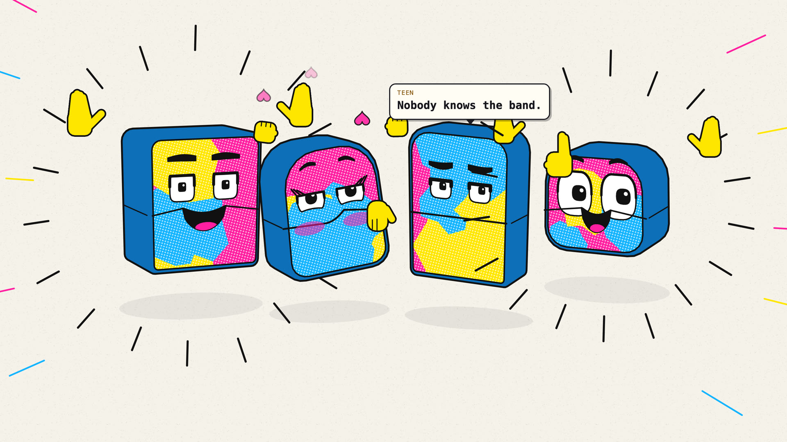
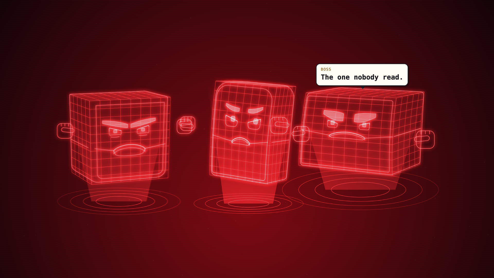
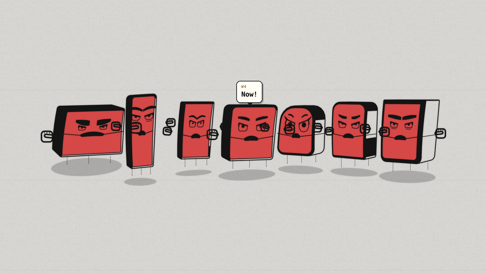
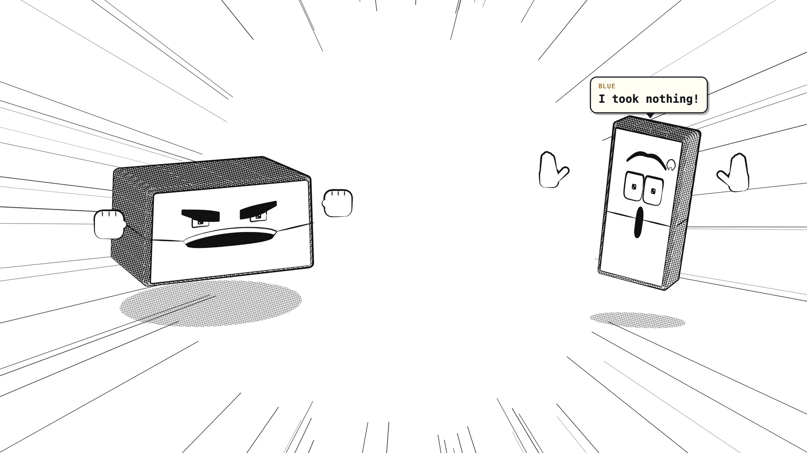
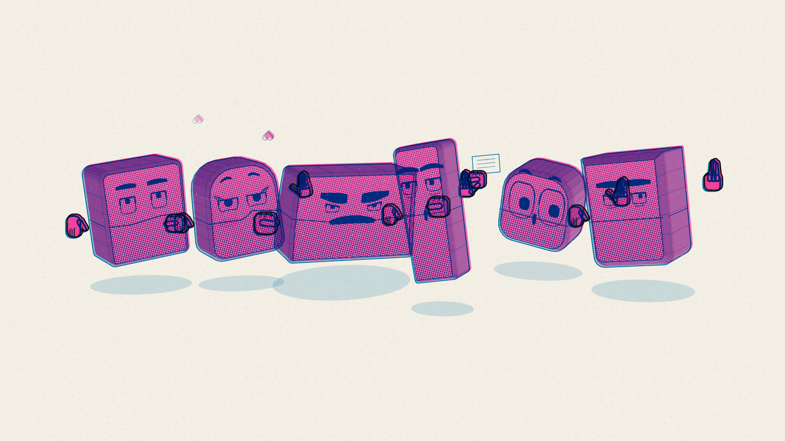
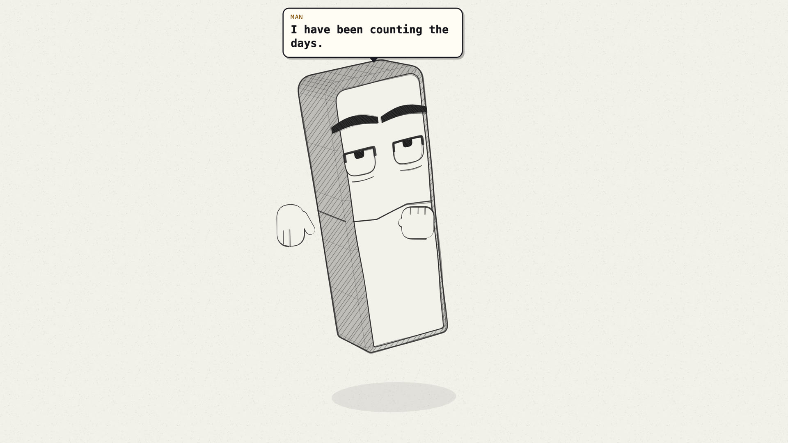
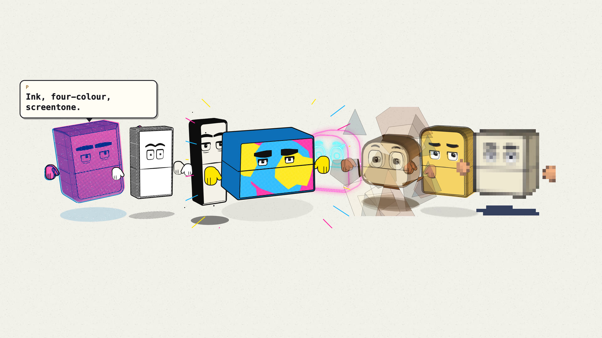
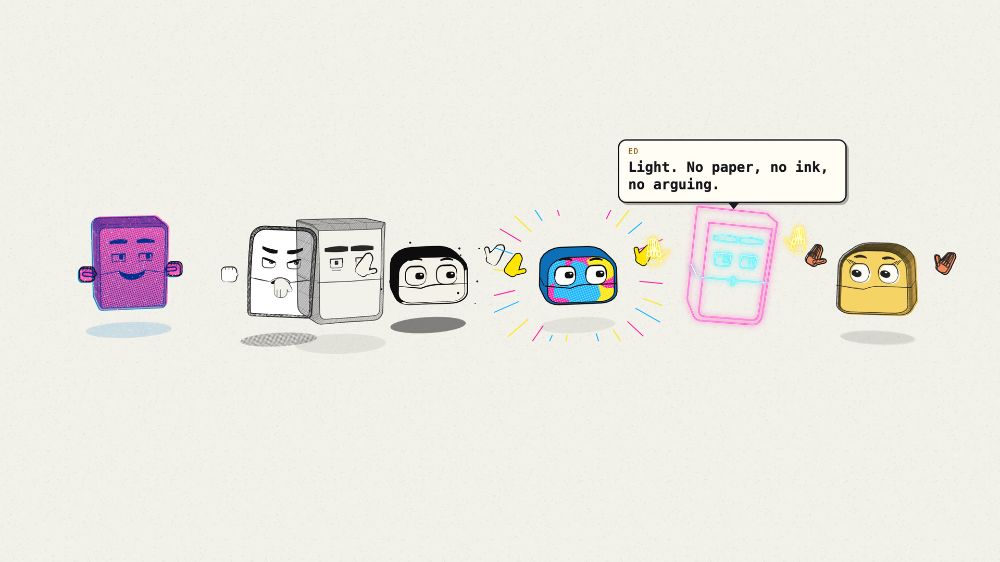
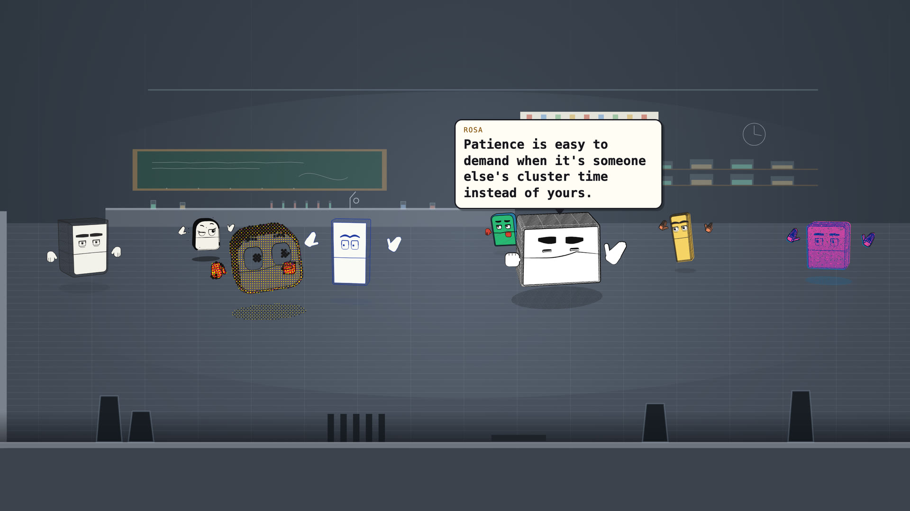
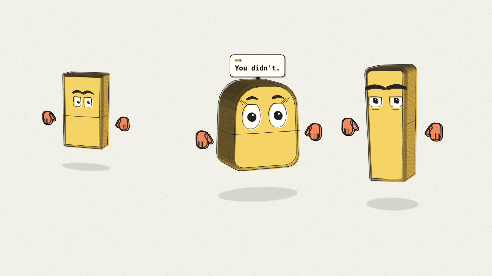

# agent-neuron-stage

A stage for [agent-neuron](https://github.com/overfocus/agent-neuron) networks,
drawn by [maxcot](https://github.com/shibli21/maxcot): a network is a cast, a run
is a performance.

A neuron becomes a character. Its `id` names it, its `description` is what it
is, its kind decides how it carries itself, and a link is who it turns to. Run
the network, and its trace is the script: every answer is a line and a face,
every quiet is a shrug, every dropped line is a refusal, and the reply chain is
the scene. A character can be one neuron or a network of its own (a composed
neuron), so a character with a mind inside it is a file this repo already
knows how to draw.

## Built on maxcot

The room a show is set in is the stage's own: `src/labskin.ts` gives the
laboratory (`skin: "laboratory"`) a floor, a back wall, a blackboard, shelves of
glassware, a bench and a poster, and maxcot's pencil still draws every figure
over it. The room is drawn in **the stage's own projection** - the floor line,
the wall and the props are built from one actor's camera, so a character's feet
are on the floor it stands on at the depth it stands at, and the room pans and
scales with every shot the way the cast does. A ground cannot cover the actors,
so the near bench is a plate the host lays over the finished frame.

The characters, the skins, the poses and the film are
**[maxcot](https://github.com/shibli21/maxcot)**, by
[shibli21](https://github.com/shibli21): one rig, 26 visual skins, 8 actors, a
film player and a bars-and-beats sequencer, drawn entirely in code — no images,
no sprites, every line and halftone dot generated each frame. It is vendored
here unmodified (MIT) because its workspace publishes nothing to npm yet, and
every drawing on this stage is maxcot's (see `NOTICE`).

**A huge thank you to shibli21.** This project is a stage built out of that
engine: the part that decides what happens is agent-neuron's, and everything
that looks alive is maxcot's. The one thing the stage adds to the picture is
page text (a speech bubble), and it would rather maxcot grew that itself.


## Run it

```sh
npm install
npm run dev            # http://localhost:5210
```

The page opens on **duet**: two characters, each a three-neuron mind, meeting
on a stage. The run behind it is real (`examples/duet/`, four engine
processes), and its trace is committed at `src/traces/duet.json`. **writer** is
a network's answer: one program that writes a scene and answers with it
(`examples/writer/`). **alerts** is a recording shipped with agent-neuron: a
network with six neurons and 261 events, compiled the same way. **troupe** is
the other way round: six characters, each one neuron, each answering with its own
line, face and hand (`examples/troupe/`). **the lab** is the same door with a
model behind it: seven scientists in a lab at 2am, each a neuron with its own
voice and its own place in a room with depth, arguing about the Riemann
hypothesis with nobody taking turns (`examples/lab/`) — the question goes to
everyone, every answer goes to the two or three people that scientist talks to,
and each decides for itself whether to take the floor, so two runs are two
conversations. Under them, the **scene book**: twelve
hand-written scores, one to eight characters each, from a graphite solo to a
stencilled mob — and a scene where the blocking is the story and the characters
walk (`scenes/12-a-walk.score`; `n` and `p` step through them).

- **play / pause** (space), **scrub**, **½×** and **2×**: the film is the run
  on one clock, and the speed is yours.
- **bubbles | caption**: a line hangs over the speaker's head, tail on the head,
  and follows the camera through a cut. A bubble keeps its second on screen and
  never covers another, so a crowded room has two or three up at once; switch to
  one line under the picture for a dense run. The switch is remembered.
- **cast**: every neuron as an actor, with the maxcot actor that plays it, its
  kind, its weight and its line of description. Click a row, or a character on
  the stage. Each row also picks that character's **skin** (any of maxcot's 26,
  or the show's own): change it and the stage repaints that one person at once,
  which is how a mixed cast is tried out before it is written into a program.
- **net**: the run before it became a film — each neuron a dot where the network
  file put it, each link an arrow, and underneath, the mind every one of them
  talks to. For **the lab** that badge is the model (`glm-5.3-flash:cloud`); a
  trace does not record which model a program called, so a loaded file says so
  instead of guessing. It is live: while the film plays, the line being spoken
  runs along the links that carried it, the speakers light up, and a log under
  the chart names the last few transmissions (`cue → ada`, `rosa answers bruno`)
  at the second they reach the film.
- **score**: the show as a maxcot score, which is the record of the
  compilation. It is what `node scripts/score.mjs <trace.json>` prints to
  stdout, and maxcot's own studio plays it.
- **events**: the trace, event by event, with the line each one carried.
- **open a file**: a `.json` trace is compiled and played; a `.score` (or a
  JSON score document) is played as it is. That second door is how a network
  that answers with a score becomes a show.

## The idea, in four lines

1. **A neuron is an actor.** The header of a trace is a cast list already
   (id, kind, description); the links are the blocking.
2. **A composed neuron is a character with a mind.** Its inside is a network
   the engine seals: the stage sees one body and one voice.
3. **Interactions are the links.** A signal is who looks at whom; a reply
   chain is an exchange; the body turns to whoever it addresses, and `maxHops`
   is how long an argument lasts.
4. **A payload may direct its own performance.** An answer that carries
   `{ say, pose, look, shot, skin }` — the line, and the face to say it with —
   is drawn that way. Anything else in a payload is ignored.

`docs/DESIGN.md` is the longer version, including what maxcot does not have
yet, what that costs, and the five questions it answered on 2026-11-24.
`docs/SCORE.md` is the command reference.

## Make a trace, or a show

```sh
sh scripts/run-duet.sh             # check + run examples/duet, write src/traces/duet.json
sh scripts/writer-scene.sh         # check + run examples/writer, write examples/writer/scene.score
node scripts/score.mjs src/traces/duet.json > duet.score
node scripts/score.mjs - < a-score.json > a-score.score
```

Both `run-*` scripts want a `neuron-engine` binary: `$NEURON_ENGINE`, or the
debug build next to this repo. The trace committed here was written by
`neuron-engine 0.0.0 58d184e2b1a6` from
[agent-neuron](https://github.com/overfocus/agent-neuron) `main`.

## The scene book

Ten scenes, one file each in `scenes/`. A scene is nothing but a score: its cast,
its blocking, its lines, its look and its card — the same file maxcot's studio
plays. The page lists them under **scenes, one file each** (`n` and `p` step
through the book while you read), and `test/scenes.test.ts` holds every file to
the cast size it claims and to maxcot's own pose, skin and cast tables.

| scene | cast | look | what happens |
|---|---|---|---|
| [one](scenes/01-one.score) | 1 | pencil | an old man counts the days until he runs out of numbers |
| [duel](scenes/02-duel.score) | 2 | manga | two of them, a close-up per shout, and nothing was taken |
| [eight](scenes/03-eight.score) | 8 | teletext | the whole cast, a beat each, roll call |
| [noir](scenes/04-noir.score) | 2 | inkpunch | two and a letter, and it is his handwriting |
| [party](scenes/05-party.score) | 4 | gigposter | four of them, three spot inks, everybody talking at once |
| [six ways](scenes/06-six-ways.score) | 6 | six skins | the same six people drawn six ways, no line at all |
| [argument](scenes/07-argument.score) | 3 | hologram, red | three in a beam, cutting on the beat |
| [goodnight](scenes/08-goodnight.score) | 2 | sketch | two at the speed of someone falling asleep |
| [unit](scenes/09-unit.score) | 5 | oscilloscope | five machines, heavy and still, one of them has a name |
| [the wall](scenes/10-the-wall.score) | 7 | stencil | seven of them, one word, then quiet |
| [mosaic](scenes/11-mosaic.score) | 8 | eight skins at once | eight people, eight hands, one picture |
| [a walk](scenes/12-a-walk.score) | 3 | sketch | three of them, walking: the distance is the whole scene |

<table>
<tr>
<td></td>
<td></td>
</tr>
<tr>
<td></td>
<td></td>
</tr>
<tr>
<td></td>
<td></td>
</tr>
<tr>
<td></td>
<td></td>
</tr>
<tr>
<td></td>
<td></td>
</tr>
</table>

Three of them are not one skin: **mosaic** draws eight characters in eight skins,
**troupe** gets the same kind of cast out of a network run, and **the lab** puts
seven scientists and a question in a room with depth, talking over each other. maxcot's stage
paints a cast in a single skin by design, so those two are composited — each
actor's scene painted again in its own skin, clipped to its body
(`docs/SCORE.md`, *Mixed looks*; `spikes/003` has the numbers: 8 characters run
at 56 fps, 12 at 27, 16 at 17, 24 and up is for stills).

Every still is `media/stills/<scene>.jpg` (1920×1080), taken from the page by
`video/stills.py` — the stage as a reader sees it, cropped to the canvas, with
the bubble type scaled up for the capture. `media/social/<scene>.jpg` is the
same frame at 1200×630 for a link preview or a post.

## The film

`video/` renders the demo take for the portfolio page: a composition that steps
the real host frame by frame (not a screen recording), so the stage's springs
and camera eases are the app's and the take is repeatable. See
`video/README.md`; the film itself lives with the page that plays it. The stills
above come from the same Playwright: `video/stills.py` selects a scene, scrubs
to a named bar and beat, and shoots the canvas.


## What is where

| Path | What it is |
|---|---|
| `src/trace.ts` | reads an agent-neuron trace (format v1), tolerantly |
| `src/cast.ts` | the header as a cast: actor, manner, place, from the links |
| `src/netchart.ts` | the network as a drawing: neuron dots, link arrows, and the mind they talk to |
| `src/bubble.ts` | where a speech bubble goes: above the head, inside the frame, tail on it |
| `src/bubbles.ts` | the bubble itself, as page text over the canvas |
| `src/fromtrace.ts` | the compiler: trace → show, and the cue protocol |
| `src/fromscore.ts` | a score document → show (maxcot's syntax, or JSON) |
| `src/show.ts` | what a show is, and how it writes itself back out as a score |
| `src/host.ts` | the thin host: commands → a maxcot `Stage` and `Conductor` |
| `src/main.ts` | the page: canvases, transport, panes, file input |
| `scenes/` | the scene book: twelve scores, and the list the page offers (`index.ts`) |
| `media/` | the stills: `stills/` at 1920×1080, `social/` at 1200×630 |
| `examples/duet/` | the two-character network, its minds, its inputs |
| `examples/writer/` | one program that answers a whole scene, and the scene it answered |
| `examples/troupe/` | six characters as six neurons, each with its own line and its own skin |
| `examples/lab/` | seven scientists, each a neuron and its own voice, a model answering in each |
| `video/stills.py` | a still per scene, from the page, for the README and for posting |
| `spikes/` | throwaway experiments with a verdict: facing, speech bubbles, mixed skins and a cast of many |
| `vendor/maxcot/` | maxcot's library, unmodified, MIT (see `vendor/VENDORED.md`) |

## Check

```sh
npm run check          # tsc, vitest (59 tests), vite build
```

The tests compile both committed traces, play a show through maxcot's real
conductor and stage in Node, and scrub it two ways to the same state. They also
pin the two rules that keep this honest: every pose the compiler emits exists
in maxcot's rig, and every command it emits is one the stage knows.

## It is a local tool

Nothing is deployed, nothing is uploaded, and no trace is fetched from
anywhere: the page reads the two bundled traces or a file you pick. No push to
`main` without Kevin's go-ahead.
